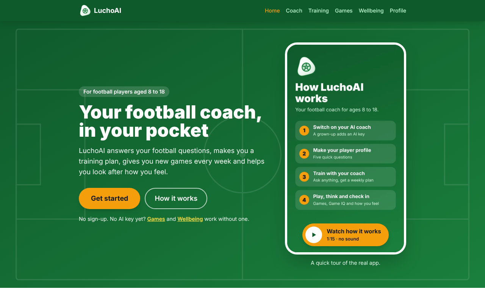
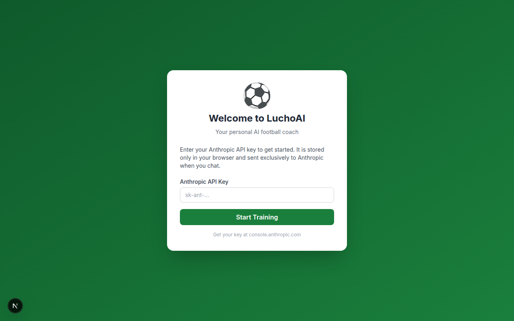

# LuchoAI ⚽

An AI-augmented coaching platform for young football (soccer) players aged 8–18. Get personalised training plans, technical skill advice, and tactical guidance powered by your choice of AI provider.



The home page explains how LuchoAI works in four steps (switch on your AI coach, make your player
profile, train with your coach, then play and check in), says which parts need an AI key, and
answers parents' questions. It also has a short video tour recorded from the real app.

## Features

- **AI Coach Chat** — Ask your personal AI coach anything about football, technique, and tactics
- **Training Plan Generator** — Generate a personalised weekly training plan based on your position and skill level
- **Player Profile** — Set up your profile so coaching is tailored to your age, position, and goals
- **Weekly Games** — A fresh set of practice games every Monday, picked from a growing library to match each player's goals, age and level: one to play alone, one with a friend, one with a group and one new thing to try, plus a match mission to take to their next game (no AI key needed)
- **Game IQ** — Decision games on moving into space, first touch, pressing, defending together, quick counter-attacks, when to shoot or pass, using the spare player and switching the play, and reacting fast after the ball is lost or cleared. Watch the play build up, make your move on the pitch (drag yourself or the ball with a mouse or finger, or tap a spot), then see what happens, plus on-pitch games to practise each one
- **Wellbeing** — Daily mood and life-balance check-in, calm breathing, a mistake reset routine, and free helplines for young people (check-ins never leave the device)
- **Privacy** — A plain-language page on what is saved on the device, what is sent to the AI company and where, with a button that deletes everything LuchoAI saved
- **Multi-provider AI** — Choose from Anthropic Claude, Google Gemini, or Hugging Face models



## AI Providers

LuchoAI supports three AI providers. You choose your provider and model on first launch; your API key is stored only in your browser.

| Provider | Models | Get a key |
|---|---|---|
| Anthropic (Claude) | Claude Opus 5.5, Sonnet 5.5, Haiku 5.5 | [console.anthropic.com](https://console.anthropic.com) |
| Google Gemini | Gemini 3.6 Flash, 3.5 Flash, 3.5 Flash-Lite | [aistudio.google.com](https://aistudio.google.com) |
| Hugging Face | gpt-oss 120B, GLM 5.3, DeepSeek V4.1 Flash, Qwen 3.8 27B | [huggingface.co/settings/tokens](https://huggingface.co/settings/tokens) |

Hugging Face requests run on [Inference Providers](https://huggingface.co/docs/inference-providers), which bill against your account's monthly credits (free accounts get a small allowance).

## Quick Start

```bash
npm install
npm run dev
```

Open [http://localhost:3000](http://localhost:3000), choose your AI provider, select a model, and enter your API key to start.

### Try a change before you deploy it

```bash
npm run preview            # this computer: http://localhost:4173/luchoAI/
npm run preview -- --host  # also prints an address for a phone on the same Wi-Fi
```

This builds the site exactly as the deploy does and serves it at the same addresses as GitHub
Pages, so you can click through a change before pushing to `main`. Nothing is published. The
"Try 5 free questions" button only appears if `GEMINI_FREE_API_KEY` is set when you run it.

### Re-record the home page video

```bash
NODE_ENV=production NEXT_PUBLIC_BASE_PATH= npm run build && npm run tour-video
```

The tour is recorded from the real app in a browser, with canned AI replies (no key, no real AI
calls). It needs [ffmpeg](https://ffmpeg.org) and writes `public/video/how-luchoai-works.mp4`
plus its poster. Re-record it whenever a screen it shows changes. The recording then checks that
the voice-over and captions are in sync (`node e2e/tour-video-sync.mjs` runs that check alone).

**The voice-over.** Each caption is read out by an AI voice: Kokoro-82M, an open text-to-speech
model from Hugging Face (Apache-2.0), with its British `bf_emma` voice. The words live once, in
`scripts/tour-voice/lines.json` (one line = one caption = one recording), and the recordings are
committed in `scripts/tour-voice/clips/`, so re-recording the video after a screen change needs
no Python. After editing a line, record the voice again, check it, then re-record the video:

```bash
# Once per machine (Python 3.12): about 1.3 GB with the Whisper model, downloaded on first check
python3.12 -m venv ~/tour-voice && . ~/tour-voice/bin/activate
pip install kokoro-onnx==0.6.1 soundfile==0.14.0 faster-whisper==1.2.1
mkdir -p ~/kokoro/voices
B=https://huggingface.co/onnx-community/Kokoro-82M-v1.0-ONNX/resolve/1939ad2a8e416c0acfeecc08a694d14ef25f2231
curl -fL -o ~/kokoro/model.onnx "$B/onnx/model.onnx"
curl -fL -o ~/kokoro/voices/bf_emma.bin "$B/voices/bf_emma.bin"

python scripts/tour-voice/generate.py --phonemes   # read how each line will be said
python scripts/tour-voice/generate.py              # one MP3 per line, and its length
HF_HUB_DISABLE_XET=1 python scripts/tour-voice/check_speech.py   # Whisper hears every word
NODE_ENV=production NEXT_PUBLIC_BASE_PATH= npm run build && npm run tour-video
HF_HUB_DISABLE_XET=1 python scripts/tour-voice/check_speech.py --video public/video/how-luchoai-works.mp4
```

The downloads need `huggingface.co` and its file host `us.aws.cdn.hf.co`. Fix a word the voice
says wrongly with `SPOKEN` (a respelling, such as "IQ" read as "eye-Q") or `PHONEMES` in
`generate.py`; the captions keep the written form.

## Architecture

Fully static Next.js site — no server. All AI calls go directly from the browser to the provider's API using the key you enter. The multi-provider routing lives in `src/lib/claude.ts`; provider definitions (models, key validation, hints) are in `src/lib/providers.ts`.

```
src/lib/
  claude.ts      # Unified AI client — dispatches to the right provider SDK
  providers.ts   # Provider + model definitions (name, logo, key hints)
  storage.ts     # localStorage helpers — provider config + player profile
```

## Environment Variables

No server-side secrets. For local development, create `.env.local` (gitignored):

```
NEXT_PUBLIC_ANTHROPIC_API_KEY=sk-ant-...   # pre-fills the API key field for Anthropic
NEXT_PUBLIC_BASE_PATH=                      # leave empty for local dev
```

## Deploy

This app is deployed as a static site on GitHub Pages. Enable GitHub Pages in repo **Settings → Pages → Source: GitHub Actions**, then push to `main`.

Live URL: `https://ale-sanchez-g.github.io/luchoAI/`

## Dependency security (Project Sentinel)

A weekly workflow finds vulnerable dependencies, traces where they are used, applies patch/minor
fixes, runs the full validation (unit tests with per-test coverage attribution, lint, build, e2e
browser scripts, audits) and decides deterministically, without AI, whether the pull request can
auto-merge, needs review by the owners of the impacted files, or is blocked.
See [docs/sentinel](./docs/sentinel/README.md).

## Development

See [CLAUDE.md](./CLAUDE.md) for full architecture, conventions, and AI integration details.
