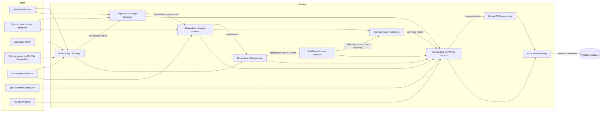
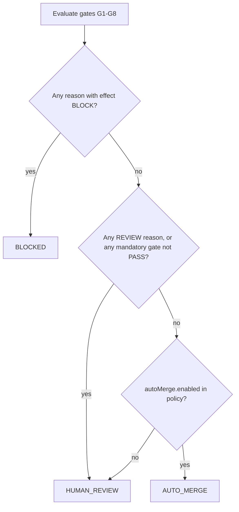

# Project Sentinel: architecture

Sentinel is a deterministic dependency-vulnerability remediation engine. It uses no AI or LLM
service at any point: every decision is computed from recorded evidence by fixed rules, and the
same evidence plus the same policy always gives the same decision.

## Modules



| Module | Code | Input contract | Output contract |
|---|---|---|---|
| Vulnerability Discovery | `sentinel/src/vulnerabilities/`, `graph/` | npm audit v2 JSON, lockfile v2/v3, optional OSV/Dependabot/advisory API data, registry version lists | `vulnerability-report.json`: root-cause advisories, installed instances with dependency paths, direct/transitive, scope, fix assessment per instance |
| Dependency Usage Discovery | `sentinel/src/usage/` | vulnerability report, repository files, lockfile (bins, dependency chains) | `dependency-usage-report.json`: every reference with file, line, relationship, confidence and detector; usage status `USED_DIRECTLY`, `USED_TRANSITIVELY`, `TOOLING_ONLY` or `UNKNOWN` |
| Dependency Impact Analysis | `sentinel/src/impact/` | usage report, local import graph, classification globs, registry metadata for planned versions | `impact-report.json`: impacted files with traces, dependent modules, entry points, compatibility risk signals |
| Test Coverage Intelligence | `sentinel/src/coverage/` | impact report, Istanbul/LCOV/Coverage.py data, Jest results, per-test attribution, test discovery list | `coverage-report.json`: one of 7 statuses per impacted file, with associated tests and metrics |
| Dependency Remediation | `sentinel/src/remediation/` | vulnerability report, policy | modified `package.json`/`package-lock.json`, `remediation-report.json`, `remediation.patch` |
| Test Execution and Validation | `sentinel/src/validation/` | configured commands | `validation-report.json`, raw evidence files |
| Governance and Merge Decision | `sentinel/src/governance/` | all reports above, PR facts, branch protection facts, CODEOWNERS | `merge-decision.json` (pure function of its inputs; input digests recorded) |
| GitHub PR Management | `sentinel/src/github/` | merge decision, reports | PR created/updated, labels, reviewers, assignees, sticky comment, auto-merge on/off; `pr-management-report.json` |
| Audit and Reporting | `sentinel/src/pipeline/summary.ts`, `core/report-io.ts` | all reports | `execution-summary.json`, Markdown step summary |

Business logic never reads GitHub Actions variables directly: the CLI translates environment and
event data into typed inputs, so every module can be tested and reused outside Actions.

## Workflows and trust boundaries

```mermaid
sequenceDiagram
  autonumber
  participant Cron as Schedule / dispatch
  participant R as weekly: remediate (read-only)
  participant V as weekly: validate (read-only, runs updated deps)
  participant P as weekly: publish (write)
  participant GH as GitHub
  participant E as PR: evidence (read-only, runs PR code)
  participant D as PR: decide (write, trusted code only)

  Cron->>R: checkout default branch
  R->>R: npm ci --ignore-scripts (trusted lockfile), build Sentinel
  R->>R: scan, usage, impact, plan, npm --package-lock-only
  R->>GH: upload "sentinel-plan" artifact (patch + reports), before any new code runs
  R->>V: needs
  V->>V: apply patch, npm ci --ignore-scripts, run tests+coverage, lint, build, e2e, audits
  V->>GH: upload "sentinel-weekly-evidence" (all reports, preliminary decision)
  V->>P: needs (runs even if validation failed)
  P->>P: checkout default branch, build Sentinel from it
  P->>P: re-verify patch (allowed files, fields, registry), commit
  P->>GH: push sentinel/dependency-remediation (only if content changed), create or update PR
  P->>GH: workflow_dispatch PR validation (only when using GITHUB_TOKEN)
  GH->>E: pull_request opened/synchronize (or dispatch)
  E->>E: checkout PR head, npm ci --ignore-scripts, tests+coverage, lint, build, e2e, audits (base and head)
  E->>GH: upload "sentinel-pr-evidence"
  E->>D: needs (runs even if evidence failed)
  D->>D: checkout base SHA (Sentinel code + policy), PR head as data only
  D->>D: evaluate: discovery, usage, impact, remediation check, coverage, gates
  D->>GH: re-read live PR head SHA; if it changed, stop (stale)
  D->>GH: labels, sticky comment, CODEOWNERS reviews/assignees, enable or disable auto-merge
  D-->>GH: job conclusion = decision gate (fails only for BLOCKED)
```

Rules that keep the boundaries:

- Jobs that execute dependency code (tests, builds, e2e) never hold a write token or secrets.
- Write-capable jobs check out the trusted default/base branch, run `npm ci --ignore-scripts`
  from its lockfile, build Sentinel from source, and treat every artifact as untrusted JSON.
  They never execute files from the PR or from artifacts.
- The remediation patch is uploaded before the updated dependencies are installed or executed,
  so the published change cannot be altered by code that ran during validation.
- Repository files of the PR are read with `lstat` and symlinks are skipped, so a crafted
  symlink cannot pull runner files into reports.
- `actions/checkout` runs with `persist-credentials: false` everywhere except the one push step.
- All actions are pinned to full commit SHAs; caching is disabled in privileged jobs.
- Auto-merge is only enabled through GitHub's native auto-merge, which still enforces branch
  protection. Sentinel never merges directly.

## Decision model

Each gate yields `PASS`, `FAIL`, `UNKNOWN` or `NOT_APPLICABLE`, with reasons. Each reason has an
effect: `BLOCK`, `REVIEW` or `INFO`.



| Gate | Passes when | Typical REVIEW reasons | Typical BLOCK reasons |
|---|---|---|---|
| G1 Remediation completed | every targeted advisory is gone from the post-change audit and nothing new appeared | major upgrade required, target not resolved, no fix (if policy says so) | new vulnerability introduced, remediation command failed, audit unavailable |
| G2 Usage analysis completed | usage known for every targeted package, no parse failures or unresolved dynamic imports in production code | usage unknown, partial analysis | - |
| G3 Impact analysis completed | every impacted file traced; no unknown impact scope; no compatibility risk | build-tool scope unknown, engines/peer changes, 0.x minor bump | - |
| G4 Attributable coverage | every impacted file that policy requires evidence for is `TESTED_AND_COVERED` (or its config validated) | not tested, insufficient, test not executed, coverage unavailable, attribution missing | coverage report malformed, associated test failed |
| G5 Required tests passed | the full suite ran, all discovered tests executed, none failed or (by default) skipped | skipped tests | failures, runtime errors, results missing |
| G6 Builds and security checks | build, lint, e2e, audits, lockfile integrity, signatures all pass | a security check was unavailable | build/lint failure, invalid signatures, registry not allowed |
| G7 No governance restriction | only allowed files changed, only dependency fields edited, no new install scripts, licence unchanged, release older than the minimum age, ownership resolved | any of these | - |
| G8 Merge requirements | base branch protected, Sentinel's check is a required status check, auto-merge allowed, evidence matches the live PR head | protection unreadable or insufficient | stale evidence |

Outcome semantics:

- `AUTO_MERGE`: Sentinel enables GitHub auto-merge. GitHub merges only after every branch
  protection requirement (including required reviews, if configured) is met.
- `HUMAN_REVIEW`: auto-merge is disabled if it was on, CODEOWNERS (or the fallback team) are
  requested and assigned, labels explain why. The Sentinel check passes, so a reviewer can merge.
- `BLOCKED`: as above, plus the Sentinel check fails, so branch protection prevents merging.

## Reports

All reports share a header (`schemaVersion`, `reportType`, `executionId`, `generatedAt`,
`repository` with commit SHA, `tool`, `limitations`) and are validated against JSON Schemas in
`sentinel/schemas/` before they are written. Paths are POSIX and relative to the repository root.

| File | Producer |
|---|---|
| `repository-discovery.json` | `sentinel discover-repo` |
| `vulnerability-report.json` | `sentinel scan` |
| `dependency-usage-report.json` | `sentinel usage` |
| `impact-report.json` | `sentinel impact` |
| `remediation-report.json` | `sentinel remediate` / `evaluate-pr` |
| `validation-report.json` | `sentinel validate` |
| `coverage-report.json` | `sentinel coverage` / `evaluate-pr` |
| `merge-decision.json` | `sentinel decide` / `evaluate-pr` |
| `pr-management-report.json` | `sentinel publish` / `apply-decision` |
| `execution-summary.json` | every pipeline command |
